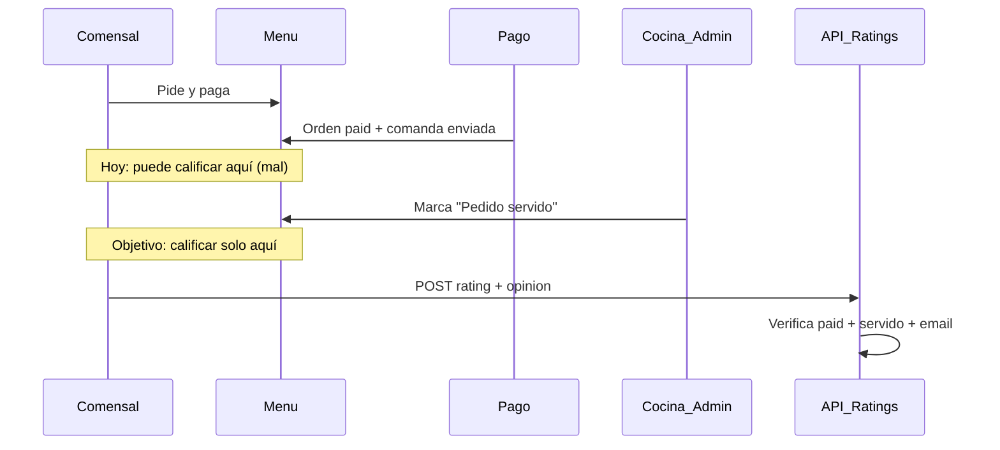
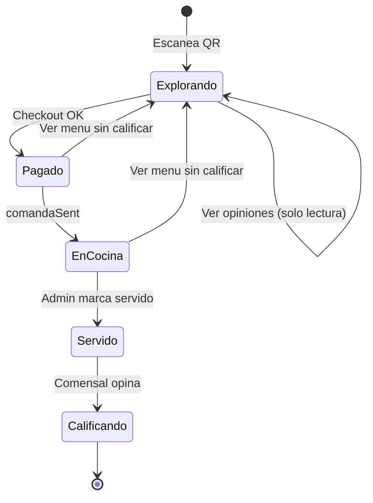

# Plan: Calificaciones después de pagar y servir

## Diagnóstico del problema actual

Tu captura muestra la **UI antigua** del menú (estrellas que califican al instante con "¡Gracias por tu voto!", sin campo de opinión). El código actual en [`src/components/product-card.tsx`](src/components/product-card.tsx) ya exige formulario (estrellas + texto) y `canRate`, y [`src/app/api/ratings/route.ts`](src/app/api/ratings/route.ts) valida compra pagada — pero **falta el paso "comida servida"** y posiblemente el navegador/Docker sigue sirviendo bundle viejo.

Además, hoy la elegibilidad solo mira `Order.status === "paid"`. Eso permite calificar **en cuanto paga**, antes de probar el platillo — justo lo que quieres evitar.



---

## Modelo propuesto (admin marca servido)

### 1. Cambio de schema

En [`prisma/schema.prisma`](prisma/schema.prisma), extender `Order`:

```prisma
model Order {
  // ...existente
  paidAt           DateTime?
  servedAt         DateTime?   // nuevo: cuándo cocina marcó servido
  ratingEligible   Boolean     @default(false)  // derivado, o solo servedAt != null
}
```

Migración: `servedAt` nullable; pedidos ya pagados quedan **sin** `servedAt` → no calificables hasta que admin los marque.

### 2. Admin: botón "Marcar servido"

En la pestaña **Pedidos** de [`src/components/admin-panel.tsx`](src/components/admin-panel.tsx):

- Para órdenes con `status === "paid"` y `servedAt == null`: botón **"Marcar servido"**.
- PATCH en [`src/app/api/admin/data/route.ts`](src/app/api/admin/data/route.ts) (`type: "order-served"`) → setea `servedAt = now()`.
- Pedidos ya servidos muestran badge "Servido" + hora.

Esto es tu señal de verdad: cocina/admin confirma que la mesa ya recibió la comida.

### 3. Reglas de elegibilidad (servidor)

Actualizar [`src/lib/purchases.ts`](src/lib/purchases.ts):

| Condición | Requerido |
|-----------|-----------|
| Email válido | Sí |
| `Order.status === "paid"` | Sí |
| `Order.servedAt != null` | **Sí (nuevo)** |
| `OrderItem.productId` coincide | Sí |
| Email en `guestEmail` o `Session.email` | Sí |

Nuevas funciones:
- `getRateableProductIds(email)` — solo productos de órdenes **pagadas y servidas**.
- `canRateProduct(email, productId)` — usada en POST `/api/ratings`.

Endurecer seguridad en POST [`src/app/api/ratings/route.ts`](src/app/api/ratings/route.ts):
- Exigir `sessionId` en el body.
- Verificar que `session.email` coincida con el email enviado (evita calificar con correo ajeno).
- Rechazar con 403 si la orden no está servida: *"Podrás calificar cuando tu pedido haya sido servido"*.

GET [`src/app/api/purchases/route.ts`](src/app/api/purchases/route.ts) → renombrar semánticamente a productos **rateables** (pagados + servidos), no solo pagados.

### 4. UX del comensal

**Quitar** el formulario de calificación del flujo de exploración del menú.

En [`src/components/product-card.tsx`](src/components/product-card.tsx):
- Mantener solo: promedio de estrellas + botón **"Ver opiniones recientes"** (3 más recientes, ya implementado en GET `/api/ratings`).
- **No** mostrar "Tu calificación" en la tarjeta del catálogo.

Nuevo componente **`RateYourOrderPanel`** (similar a [`src/components/review-panel.tsx`](src/components/review-panel.tsx)):
- Visible solo si hay productos rateables para el email de la sesión.
- Lista platillos del pedido servido con formulario estrellas + opinión por producto.
- Mensajes claros:
  - Sin correo: "Guarda tu correo arriba"
  - Pagó pero no servido: "Tu pedido está en cocina. Podrás calificar cuando te lo sirvan."
  - Servido: formulario activo

Integrar en [`src/components/menu-experience.tsx`](src/components/menu-experience.tsx) debajo del menú (reemplaza o convive con `ReviewPanel` de visita general — recomiendo **ocultar ReviewPanel** para no duplicar).

Tras pago exitoso, en [`src/components/payment-return.tsx`](src/components/payment-return.tsx):
- Mensaje: *"Pago confirmado. Tu pedido va a cocina. Te avisaremos cuando puedas calificar."*

### 5. Fix del bypass actual (deploy + datos)

1. **Reiniciar Docker** y hard refresh para cargar UI nueva (formulario + gate).
2. **Auditar ratings existentes** sin compra servida: script o query admin para listar/limpiar ratings donde no hay `OrderItem` pagado+servido.
3. Verificar que no quede código viejo con `onClick={() => submitRating(value)}` en estrellas (solo en commit actual debe ser formulario con submit).

### 6. Flujo completo objetivo



---

## Archivos principales a tocar

| Archivo | Cambio |
|---------|--------|
| [`prisma/schema.prisma`](prisma/schema.prisma) | `servedAt` en Order |
| [`src/lib/purchases.ts`](src/lib/purchases.ts) | Elegibilidad pagado + servido |
| [`src/app/api/ratings/route.ts`](src/app/api/ratings/route.ts) | Gate servido + sessionId |
| [`src/app/api/admin/data/route.ts`](src/app/api/admin/data/route.ts) | `order-served` PATCH |
| [`src/components/admin-panel.tsx`](src/components/admin-panel.tsx) | Botón marcar servido |
| [`src/components/product-card.tsx`](src/components/product-card.tsx) | Solo lectura de opiniones |
| `src/components/rate-your-order-panel.tsx` | **Nuevo** — calificar post-servicio |
| [`src/components/menu-experience.tsx`](src/components/menu-experience.tsx) | Integrar panel + estados |
| [`src/app/api/purchases/route.ts`](src/app/api/purchases/route.ts) | Devolver solo rateables |

---

## Fuera de alcance (fase 2 opcional)

- Notificación push/polling cuando admin marca servido (hoy: el comensal refresca o ve el panel al volver al menú).
- Pantalla de cocina dedicada (KDS) — por ahora basta el botón en admin Pedidos.
- Calificar por ítem parcial (ej. llegó solo la entrada) — fase 2 con `OrderItem.servedAt` si lo necesitan.
